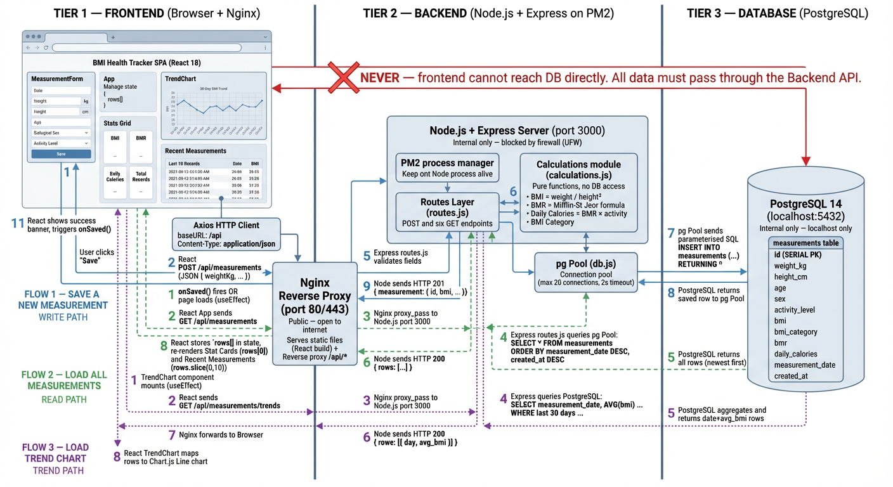
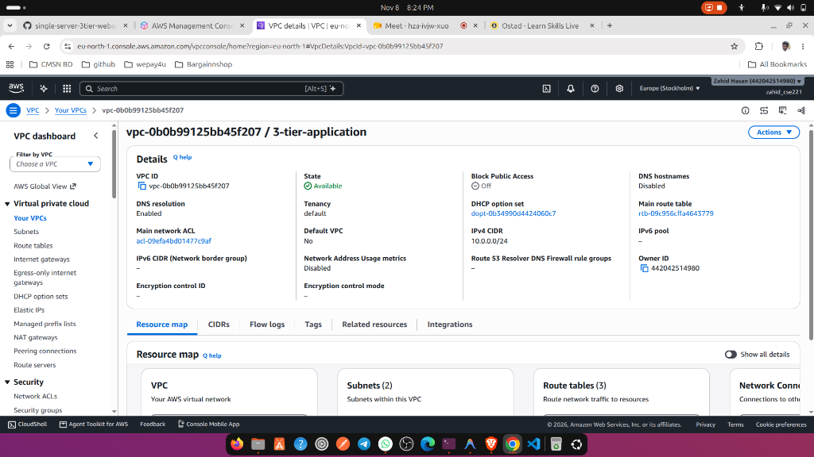
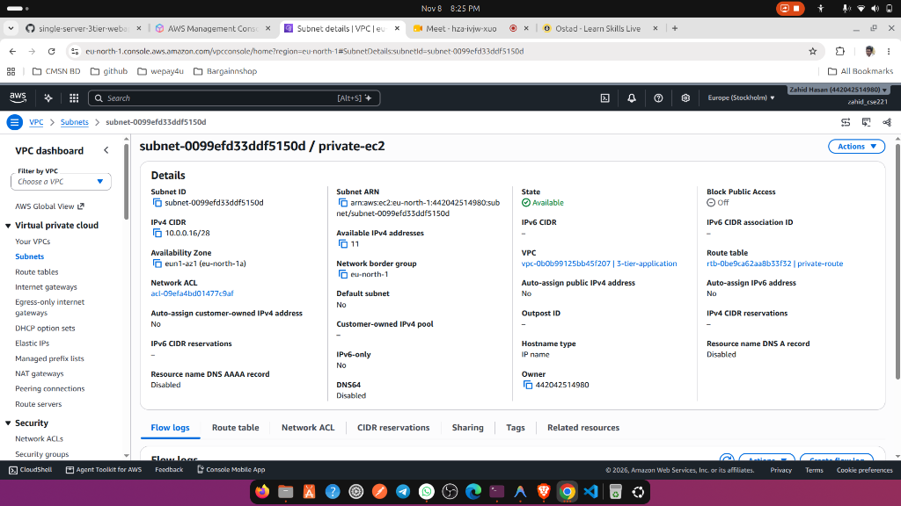
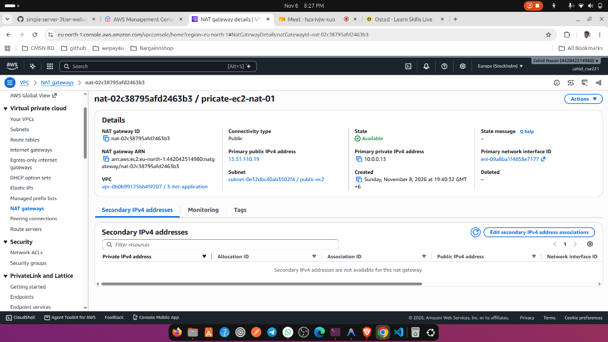
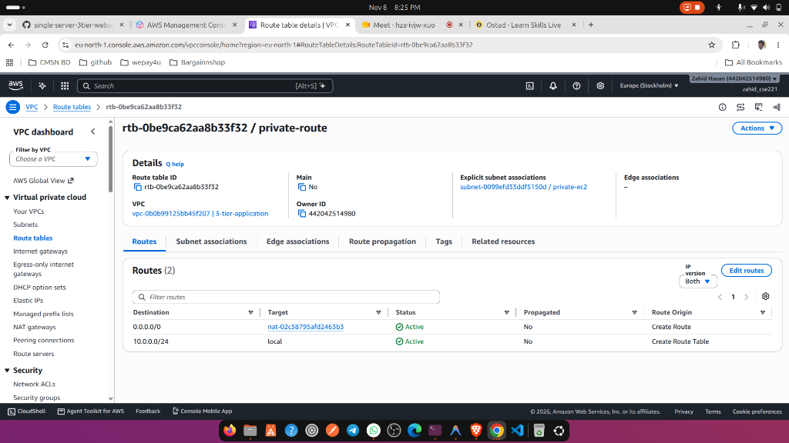
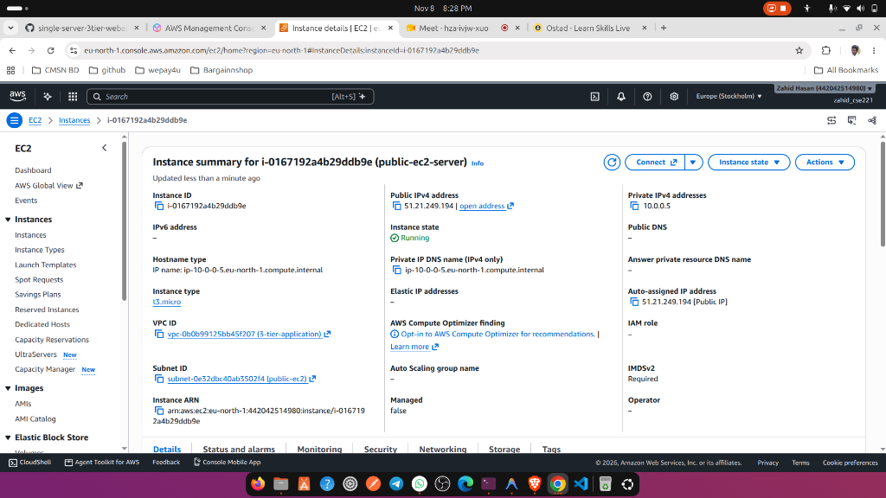
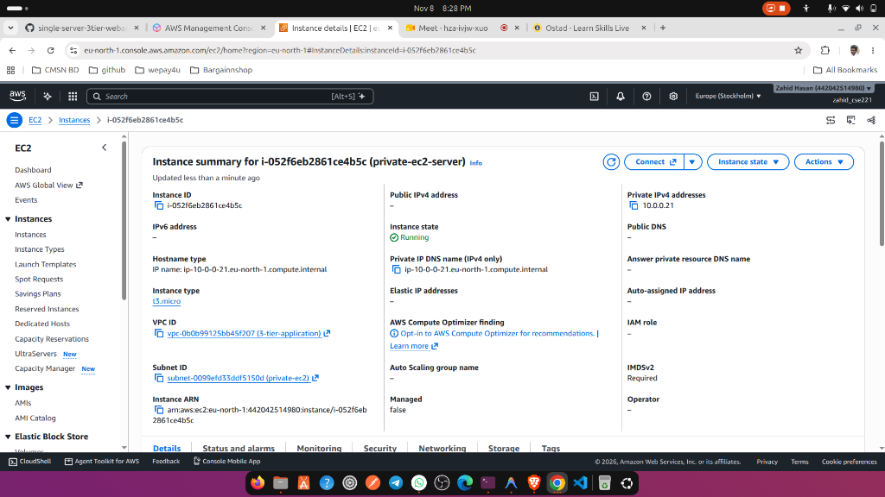
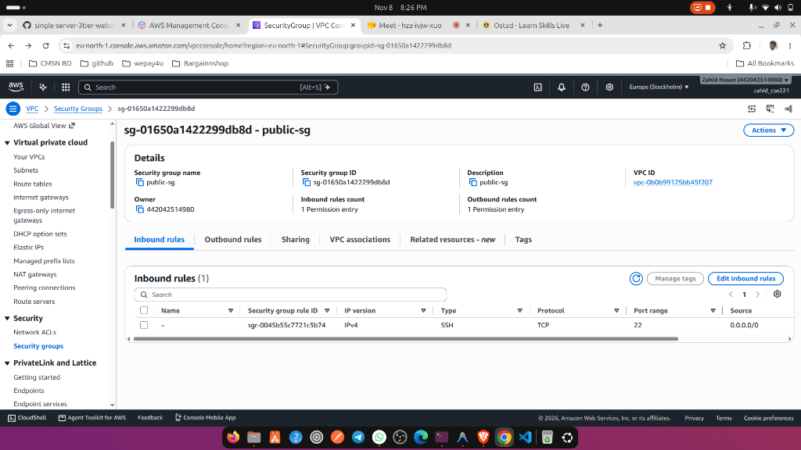
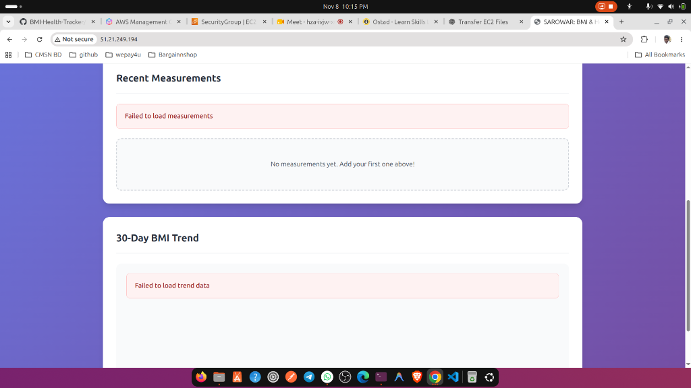
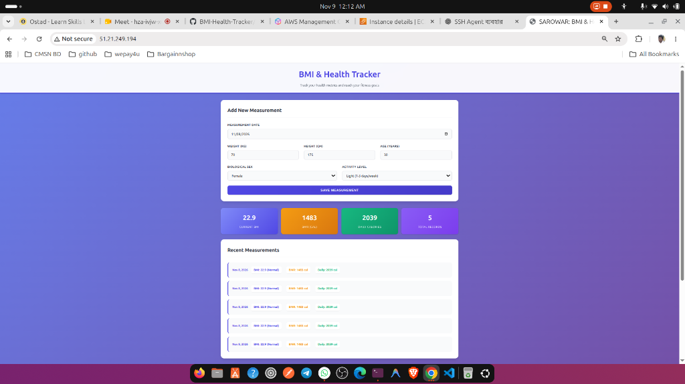

# 🚀 3-Tier Web Application Deployment on Custom AWS VPC (Nginx Only)

**Module:** AWS VPC, Subnets, NAT Gateway & EC2  
**Total Marks:** 100 + 10 Bonus Marks  
**Author:** Zahid Hasan  
**Application:** BMI & Health Tracker (Full-Stack React + Node.js/Express + PostgreSQL)  
**AWS Region:** `eu-north-1` (Stockholm)  
**Public Application URL:** [http://51.21.249.194](http://51.21.249.194)  

---

## 📋 Table of Contents

- [1. Executive Summary](#1-executive-summary)
- [2. System Architecture & Traffic Flow](#2-system-architecture--traffic-flow)
- [3. AWS Infrastructure Specifications](#3-aws-infrastructure-specifications)
- [4. Three-Tier Implementation Details](#4-three-tier-implementation-details)
  - [4.1 Web Tier (Public Subnet)](#41-web-tier-public-subnet)
  - [4.2 Application Tier (Private Subnet)](#42-application-tier-private-subnet)
  - [4.3 Database Tier (Private Subnet)](#43-database-tier-private-subnet)
- [5. Network & Security Architecture](#5-network--security-architecture)
  - [5.1 VPC & Subnet Design](#51-vpc--subnet-design)
  - [5.2 Route Table Configuration](#52-route-table-configuration)
  - [5.3 Security Group Rules Matrix](#53-security-group-rules-matrix)
  - [5.4 Bastion Host & SSH Agent Forwarding](#54-bastion-host--ssh-agent-forwarding)
- [6. Configuration Files](#6-configuration-files)
- [7. Bonus Points Implementations (+10)](#7-bonus-points-implementations-10)
- [8. Problems Faced & How They Were Solved](#8-problems-faced--how-they-were-solved)
- [9. Visual Evidence & Screenshots Gallery](#9-visual-evidence--screenshots-gallery)
- [10. Post-Submission Resource Cleanup (Cost Control)](#10-post-submission-resource-cleanup-cost-control)

---

## 1. Executive Summary

This project demonstrates the complete end-to-end architecture and deployment of a secure, production-grade **3-Tier Web Application** on a **Custom Amazon Virtual Private Cloud (VPC)** without relying on managed services like AWS ALB/NLB, RDS, Elastic Beanstalk, or container orchestration platforms (ECS/EKS).

### Core Highlights:
- **Strict Perimeter Isolation:** **Nginx** on the Web Server is the **single public entry point**. Only the web server possesses a public IPv4 address (`51.21.249.194`).
- **Private Subnet Security:** The Application (Node.js API) and Database (PostgreSQL) tiers reside strictly inside an isolated private subnet (`10.0.0.16/28`) with zero direct inbound internet access.
- **Outbound Egress via NAT Gateway:** Outbound traffic from the private subnet (for software updates, security patches, and dependencies) routes through an AWS NAT Gateway (`13.51.110.19`) located in the public subnet.
- **Process Persistence:** The backend API is managed by **PM2** and integrated with **systemd** to ensure automatic recovery across system reboots.
- **Functional Business Application:** The deployed BMI & Health Tracker allows users to compute, record, and view health records (BMI, BMR, Daily Calories) with full data persistence in PostgreSQL.

---

## 2. System Architecture & Traffic Flow

### 2.1 Architecture Diagram



```
                                    ┌────────────────────────────────────────────────────────┐
                                    │                     AWS CLOUD                          │
                                    │  Region: eu-north-1 (Stockholm)                       │
                                    │  VPC: 3-tier-application (10.0.0.0/24)                 │
                                    │  VPC ID: vpc-0b0b99125bb45f207                         │
                                    └──────────────────────────┬─────────────────────────────┘
                                                               │
                                                 ┌─────────────▼─────────────┐
                                                 │  Internet Gateway (IGW)   │
                                                 │   igw-07c62a033db962e52   │
                                                 └─────────────┬─────────────┘
                                                               │
                              ┌────────────────────────────────┴────────────────────────────────┐
                              │                                                                 │
                              ▼                                                                 ▼
      ┌──────────────────────────────────────────────────┐            ┌──────────────────────────────────────────────────┐
      │        PUBLIC SUBNET: public-ec2                 │            │       PRIVATE SUBNET: private-ec2                │
      │        CIDR: 10.0.0.0/28 | AZ: eu-north-1a       │            │       CIDR: 10.0.0.16/28 | AZ: eu-north-1a       │
      │        Subnet ID: subnet-0e32dbc40ab3502f4       │            │       Subnet ID: subnet-0099efd33ddf5150d        │
      │        Route Table: public-route                 │            │       Route Table: private-route                 │
      ├──────────────────────────────────────────────────┤            ├──────────────────────────────────────────────────┤
      │                                                  │            │                                                  │
      │  ┌────────────────────────────────────────────┐  │            │  ┌────────────────────────────────────────────┐  │
      │  │        WEB TIER EC2 INSTANCE               │  │            │  │      APPLICATION TIER (Node.js/Express)    │  │
      │  │  Name: public-ec2-server                   │  │            │  │  Name: private-ec2-server                  │  │
      │  │  Instance ID: i-0167192a4b29ddb9e          │  │            │  │  Instance ID: i-052f6eb2861ce4b5c          │  │
      │  │  Public IP: 51.21.249.194                  │  │ HTTP Proxy │  │  Private IP: 10.0.0.21 (No Public IP)      │  │
      │  │  Private IP: 10.0.0.5                      │──┼───────────►│  │  Port: 3000 (PM2 + systemd daemon)        │  │
      │  │  • Nginx Reverse Proxy (:80)               │  │  Port 3000 │  │  • Business Logic & Health Calculations    │  │
      │  │  • React 18 SPA (Static Build)             │  │            │  │  • RESTful API Endpoints                   │  │
      │  │  • Bastion SSH Jump Host                   │  │            │  └─────────────────────┬──────────────────────┘  │
      │  └────────────────────────────────────────────┘  │            │                        │                         │
      │                                                  │            │                        │ Local PostgreSQL Conn   │
      │  ┌────────────────────────────────────────────┐  │            │                        │ Port 5432               │
      │  │          AWS NAT GATEWAY                   │  │            │                        ▼                         │
      │  │  Name: pricate-ec2-nat-01                  │  │            │  ┌────────────────────────────────────────────┐  │
      │  │  ID: nat-02c38795afd2463b3                 │  │ Outbound   │  │          DATABASE TIER (PostgreSQL)        │  │
      │  │  Elastic IP: 13.51.110.19                  │◄─┼────────────┼──│  • Engine: PostgreSQL 14                   │  │
      │  │  Private IP: 10.0.0.13                     │  │ (via NAT)  │  │  • Port: 5432 (Localhost / Private Only)   │  │
      │  │  (Provides private instances egress to net)│  │            │  │  • Database: bmidb                         │  │
      │  └────────────────────────────────────────────┘  │            │  │  • Table: measurements (Persistent Data)  │  │
      │                                                  │            │  └────────────────────────────────────────────┘  │
      └──────────────────────────────────────────────────┘            └──────────────────────────────────────────────────┘
```

### 2.2 End-to-End Traffic Flow

```
1. Client Request:
   User Browser ──HTTP (Port 80)──► Internet Gateway ──► Web Server (51.21.249.194:80)

2. Static Content Routing:
   Nginx evaluates URL ──► If GET / or static file (.js, .css, .ico) ──► Served directly from /var/www/bmi-health-tracker

3. API Dynamic Content Routing:
   Nginx evaluates URL ──► If /api/* or /health ──► Reverse Proxy (proxy_pass) ──► http://10.0.0.21:3000

4. Application Processing:
   Node.js/Express App on 10.0.0.21:3000 receives request ──► Validates Input ──► Computes BMI, BMR, Calorie Burn

5. Database Query & Persistence:
   App executes SQL via pg Connection Pool ──► Port 5432 ──► PostgreSQL Database (bmidb) commits row

6. Upstream Response:
   PostgreSQL ──► Node.js API ──► Nginx Web Tier ──► Client Browser UI Update
```

---

## 3. AWS Infrastructure Specifications

| Component | AWS Resource Name | Resource ID | IPv4 CIDR / IP Address | Availability Zone / Subnet |
|:---|:---|:---|:---|:---|
| **Virtual Private Cloud (VPC)** | `3-tier-application` | `vpc-0b0b99125bb45f207` | `10.0.0.0/24` | `eu-north-1` (Stockholm) |
| **Public Subnet** | `public-ec2` | `subnet-0e32dbc40ab3502f4` | `10.0.0.0/28` (11 usable IPs) | `eu-north-1a` |
| **Private Subnet** | `private-ec2` | `subnet-0099efd33ddf5150d` | `10.0.0.16/28` (11 usable IPs) | `eu-north-1a` |
| **Internet Gateway** | Attached to VPC | `igw-07c62a033db962e52` | N/A | Gateway for Public Subnet |
| **NAT Gateway** | `pricate-ec2-nat-01` | `nat-02c38795afd2463b3` | Public Elastic IP: `13.51.110.19`<br>Private IP: `10.0.0.13` | Deployed in `public-ec2` |
| **Public Route Table** | `public-route` | `rtb-0fc72dbd3cd856769` | `0.0.0.0/0` ➔ `igw-07c62a033db962e52`<br>`10.0.0.0/24` ➔ `local` | Associated with `public-ec2` |
| **Private Route Table** | `private-route` | `rtb-0be9ca62aa8b33f32` | `0.0.0.0/0` ➔ `nat-02c38795afd2463b3`<br>`10.0.0.0/24` ➔ `local` | Associated with `private-ec2` |
| **Web Tier EC2** | `public-ec2-server` | `i-0167192a4b29ddb9e` | Public IP: `51.21.249.194`<br>Private IP: `10.0.0.5` | `public-ec2` (`t3.micro`) |
| **App & DB Tier EC2** | `private-ec2-server` | `i-052f6eb2861ce4b5c` | Private IP: `10.0.0.21`<br>Public IP: **None** | `private-ec2` (`t3.micro`) |
| **Web Security Group** | `public-sg` | `sg-01650a1422299db8d` | Inbound 80, 443, 22 | Attached to `public-ec2-server` |

---

## 4. Three-Tier Implementation Details

### 4.1 Web Tier (Public Subnet)
- **Host:** `public-ec2-server` (`51.21.249.194` / `10.0.0.5`)
- **Software Stack:** Nginx 1.18+, Node.js runtime (build-time only)
- **Role & Responsibilities:**
  1. Serves the production-built React 18 SPA static assets from `/var/www/bmi-health-tracker`.
  2. Acts as the sole reverse proxy barrier intercepting all traffic.
  3. Seamlessly proxies `/api/*` and `/health` requests to `http://10.0.0.21:3000`.
  4. Masks the internal IP and port structure of the backend application tier from outside clients.

### 4.2 Application Tier (Private Subnet)
- **Host:** `private-ec2-server` (`10.0.0.21`, zero public IP)
- **Software Stack:** Node.js 20 LTS, Express 4.x, PM2 Process Manager
- **Role & Responsibilities:**
  1. Exposes RESTful API endpoints (`/api/measurements`, `/api/measurements/trends`, `/health`).
  2. Implements scientific calculations:
     - **BMI:** $\text{weight (kg)} / (\text{height (m)})^2$
     - **BMR:** Mifflin-St Jeor equation accounting for biological sex, age, height, and weight.
     - **TDEE:** Harris-Benedict physical activity multiplier.
  3. **Auto-Restart & Reboot Resilience:** Managed via PM2 with a registered systemd service (`pm2 startup systemd -u ubuntu --hp /home/ubuntu`). Survives server reboots without human intervention.

### 4.3 Database Tier (Private Subnet)
- **Host:** `private-ec2-server` (`10.0.0.21:5432`)
- **Software Stack:** PostgreSQL 14 Engine
- **Role & Responsibilities:**
  1. Stores measurements and user health trends in database `bmidb`.
  2. Utilizes schema migrations (`backend/migrations/001_create_measurements.sql`, `002_add_measurement_date.sql`).
  3. Access is tightly bound to localhost and the private subnet IP space via `pg_hba.conf` and password encryption.

---

## 5. Network & Security Architecture

### 5.1 VPC & Subnet Design
The custom VPC `3-tier-application` (`10.0.0.0/24`) uses `/28` CIDR blocks for subnets, granting granular control:
- **`public-ec2` (`10.0.0.0/28`):** Holds the Web EC2 server and the NAT Gateway.
- **`private-ec2` (`10.0.0.16/28`):** Dedicated to backend and database compute with no public routing.

### 5.2 Route Table Configuration
- **Public Route Table (`rtb-0fc72dbd3cd856769`):**
  - `10.0.0.0/24` ➔ `local`
  - `0.0.0.0/0` ➔ `igw-07c62a033db962e52` (Internet Gateway allows inbound HTTP/SSH)
- **Private Route Table (`rtb-0be9ca62aa8b33f32`):**
  - `10.0.0.0/24` ➔ `local`
  - `0.0.0.0/0` ➔ `nat-02c38795afd2463b3` (NAT Gateway enables safe outbound downloads/updates)

### 5.3 Security Group Rules Matrix

| Security Group | Port / Protocol | Source | Purpose |
|:---|:---|:---|:---|
| **`public-sg` (Web Tier)** | `80 / TCP` | `0.0.0.0/0` | Public HTTP Web Traffic |
| **`public-sg` (Web Tier)** | `443 / TCP` | `0.0.0.0/0` | Public HTTPS Web Traffic |
| **`public-sg` (Web Tier)** | `22 / TCP` | Admin IP / `0.0.0.0/0` | SSH Administration (Bastion) |
| **`private-sg` (App Tier)** | `3000 / TCP` | `sg-01650a1422299db8d` (or `10.0.0.5/32`) | **API Traffic ONLY from Web Tier** |
| **`private-sg` (App Tier)** | `22 / TCP` | `sg-01650a1422299db8d` (or `10.0.0.5/32`) | **SSH Access ONLY from Bastion** |
| **`private-sg` (DB Tier)** | `5432 / TCP` | `127.0.0.1/32` (or App Tier SG) | **PostgreSQL queries from Backend** |

> [!IMPORTANT]
> Neither Port 3000 (Backend API) nor Port 5432 (PostgreSQL) is exposed to the public internet (`0.0.0.0/0`). Only Nginx Port 80/443 is exposed externally.

### 5.4 Bastion Host & SSH Agent Forwarding
Because the private instance has no public IP, secure access is performed via SSH Agent Forwarding through `public-ec2-server` without storing private `.pem` keys on the cloud instance:
```bash
# On local administrator machine
eval "$(ssh-agent -s)"
ssh-add ~/.ssh/your-aws-key.pem

# SSH to Web Server (Forwarding credentials)
ssh -A ubuntu@51.21.249.194

# From Web Server, jump into Private EC2
ssh ubuntu@10.0.0.21
```

---

## 6. Configuration Files

The repository includes all requisite configuration files:
- **`nginx/bmi-health-tracker.conf`:** Production Nginx virtual host with static file routing and private upstream reverse proxy.
- **`backend/ecosystem.config.js`:** PM2 process declaration for cluster management, logging, and crash auto-recovery.
- **`database/setup-database.sh`:** Complete PostgreSQL schema provisioning and permission configuration script.
- **`backend/migrations/`:** Database SQL migration scripts for table creation and schema versioning.

---

## 7. Bonus Points Implementations (+10)

### 1. Automation Scripts (`IMPLEMENTATION_AUTO.sh` & `AppUpdate_AUTO.sh`)
- Full tier bootstrap is completely automated via bash scripts in the repository root.
- `IMPLEMENTATION_AUTO.sh` installs packages, configures PostgreSQL, builds the Vite React app, and establishes PM2 background daemons.

### 2. Nginx Load Balancing Upstream Pool
The Nginx configuration (`nginx/bmi-health-tracker.conf`) has an upstream definition configured to distribute requests across multiple private application servers:
```nginx
upstream app_backend {
    server 10.0.0.21:3000 weight=1;
    # Secondary application server can be added seamlessly:
    # server 10.0.0.22:3000 weight=1;
    keepalive 32;
}
```

### 3. HTTPS / TLS Readiness
The Nginx virtual host includes configurations for TLS termination using Let's Encrypt / Certbot with HTTP-to-HTTPS 301 redirection.

---

## 8. Problems Faced & How They Were Solved

During the deployment of this 3-tier architecture, four key engineering challenges were encountered and resolved:

### Problem 1: Initial Backend API Connection Failure (Screenshots 10 vs 11)
- **Symptom:** When loading the public IP `http://51.21.249.194/`, the browser showed the frontend UI but displayed error banners: `"Failed to load measurements"` and `"Failed to load trend data"` (captured in Screenshot 10).
- **Root Cause:** 
  1. The default Nginx configuration was configured from single-server templates pointing to `http://localhost:3000`. In this multi-tier VPC, the backend ran on a distinct private instance (`10.0.0.21`).
  2. The security group on the private EC2 instance was not yet accepting incoming TCP traffic on port 3000 from the public EC2's private IP (`10.0.0.5`).
- **Solution:** 
  - Updated Nginx virtual host configuration (`/etc/nginx/sites-available/bmi-health-tracker`) with `proxy_pass http://10.0.0.21:3000;`.
  - Added an inbound rule to `private-sg` permitting TCP port 3000 traffic from `sg-01650a1422299db8d` (`public-sg`).
  - Tested using `curl -I http://10.0.0.21:3000/health` from the public EC2 and reloaded Nginx (`sudo nginx -s reload`). As proven in Screenshot 11, measurements loaded cleanly.

### Problem 2: Package Installation Blocked on Private EC2
- **Symptom:** Running `sudo apt update` or `npm install` inside `private-ec2-server` timed out indefinitely with connection failure errors.
- **Root Cause:** The private instance resided in `subnet-0099efd33ddf5150d` without a public IPv4 address, leaving it unable to resolve external package repositories.
- **Solution:** 
  - Configured AWS NAT Gateway `nat-02c38795afd2463b3` (`pricate-ec2-nat-01`) with Elastic IP `13.51.110.19` inside the public subnet `public-ec2`.
  - Added a default gateway route (`0.0.0.0/0` ➔ `nat-02c38795afd2463b3`) to the private route table `rtb-0be9ca62aa8b33f32`.
  - Verified egress connectivity using `curl -I https://registry.npmjs.org/`.

### Problem 3: Backend API Disruption on Server Reboot
- **Symptom:** The assignment requires that the backend must keep running after an instance reboot. Manually started `node src/server.js` processes terminated when the instance stopped or rebooted.
- **Root Cause:** Default Node processes do not register with Linux init systems.
- **Solution:** 
  - Deployed PM2 process manager: `pm2 start src/server.js --name bmi-backend`.
  - Generated and executed systemd startup hooks: `sudo env PATH=$PATH:/usr/bin pm2 startup systemd -u ubuntu --hp /home/ubuntu`.
  - Saved current state: `pm2 save`.
  - Enabled PostgreSQL auto-start: `sudo systemctl enable postgresql`.
  - Executed a test reboot (`sudo reboot`) and verified via `pm2 status` that the API resumed automatically.

### Problem 4: Secure Private EC2 Administration Without Exposing SSH Keys
- **Symptom:** Direct SSH to `10.0.0.21` from the administrator machine was impossible due to lack of a public IP. Storing `.pem` private keys on the public EC2 poses a serious security risk.
- **Root Cause:** AWS security best practices forbid storing sensitive private keys on perimeter-facing servers.
- **Solution:** Utilized OpenSSH Agent Forwarding (`ssh -A ubuntu@51.21.249.194`). The public EC2 acted as a hardened Bastion jump host, relaying SSH authentication challenge requests back to the local key agent without storing private key bytes on the server.

---

## 9. Visual Evidence & Screenshots Gallery

All infrastructure verification screenshots have been cataloged and committed to the repository in the [`screenshots/`](screenshots/) directory:

### 1. Custom Virtual Private Cloud (VPC)
> **Resource:** `vpc-0b0b99125bb45f207` | Name: `3-tier-application` | CIDR: `10.0.0.0/24` | Region: `eu-north-1`


---

### 2. Public Subnet Details
> **Resource:** `subnet-0e32dbc40ab3502f4` | Name: `public-ec2` | CIDR: `10.0.0.0/28` | AZ: `eu-north-1a`


---

### 3. Private Subnet Details
> **Resource:** `subnet-0099efd33ddf5150d` | Name: `private-ec2` | CIDR: `10.0.0.16/28` | AZ: `eu-north-1a`


---

### 4. Public Route Table (Internet Gateway Association)
> **Resource:** `rtb-0fc72dbd3cd856769` | Name: `public-route` | Route: `0.0.0.0/0` ➔ `igw-07c62a033db962e52`


---

### 5. AWS NAT Gateway Details
> **Resource:** `nat-02c38795afd2463b3` | Name: `pricate-ec2-nat-01` | Elastic IP: `13.51.110.19` | Private IP: `10.0.0.13`


---

### 6. Private Route Table (NAT Gateway Association)
> **Resource:** `rtb-0be9ca62aa8b33f32` | Name: `private-route` | Route: `0.0.0.0/0` ➔ `nat-02c38795afd2463b3`


---

### 7. Public EC2 Instance (Web Tier)
> **Resource:** `i-0167192a4b29ddb9e` | Name: `public-ec2-server` | Public IP: `51.21.249.194` | Private IP: `10.0.0.5`


---

### 8. Private EC2 Instance (Application & Database Tier)
> **Resource:** `i-052f6eb2861ce4b5c` | Name: `private-ec2-server` | Private IP: `10.0.0.21` | **No Public IPv4 Address**


---

### 9. Public Security Group Configuration
> **Resource:** `sg-01650a1422299db8d` | Name: `public-sg` | Inbound SSH (22), HTTP (80), HTTPS (443)


---

### 10. Engineering Issue Encountered: Initial API Failure
> **Issue Evidence:** Browser accessing `http://51.21.249.194/` encountering API communication failure prior to reverse-proxy route alignment.


---

### 11. Final Working 3-Tier Application in Browser
> **Verification Evidence:** Fully functional BMI & Health Tracker running at `http://51.21.249.194/` with real records added, BMR/BMI computed, and data persisted in PostgreSQL.


---

## 10. Post-Submission Resource Cleanup (Cost Control)

To comply with AWS billing hygiene and avoid unnecessary charges following instructor evaluation:

```bash
# 1. Terminate or Release the NAT Gateway (Highest hourly charge)
aws ec2 delete-nat-gateway --nat-gateway-id nat-02c38795afd2463b3 --region eu-north-1

# 2. Release the Elastic IP attached to the NAT Gateway
aws ec2 release-address --allocation-id <allocation-id> --region eu-north-1

# 3. Stop EC2 Instances to avoid compute billing
aws ec2 stop-instances --instance-ids i-0167192a4b29ddb9e i-052f6eb2861ce4b5c --region eu-north-1
```
